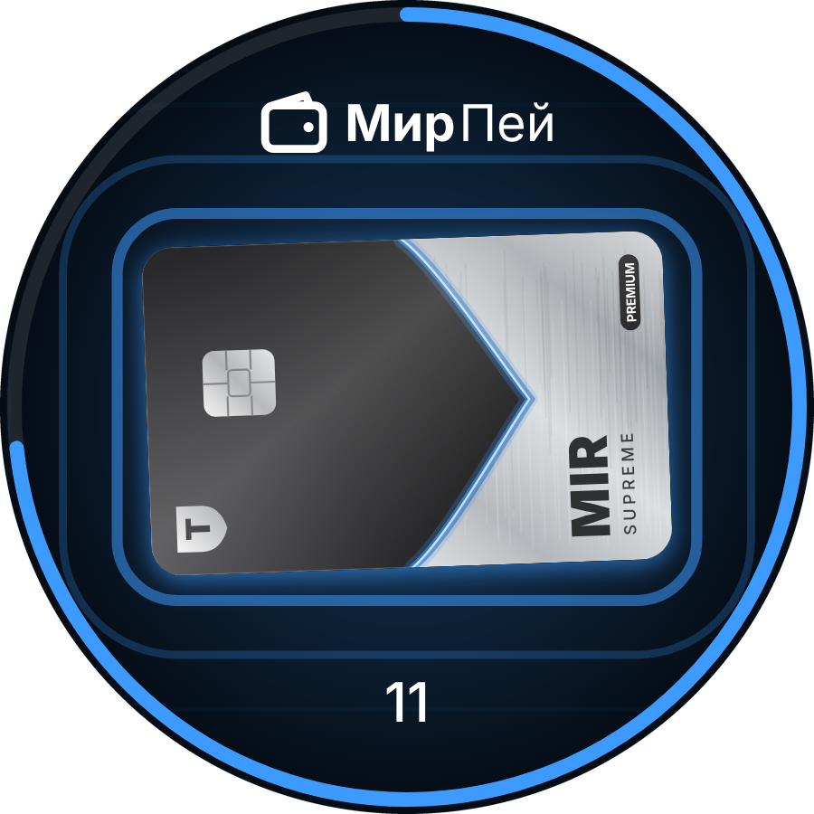
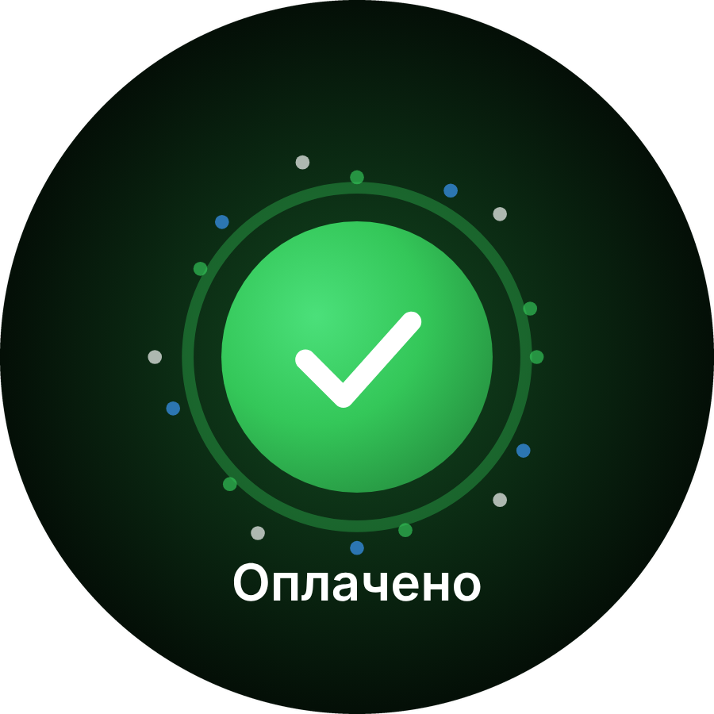
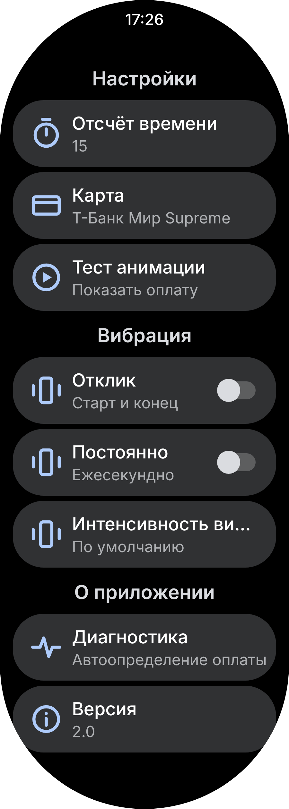

# Mir Pay Wallet

Красивый экран оплаты Mir Pay для часов на Wear OS.

| Оплата | Успех | Настройки |
| :---: | :---: | :---: |
|  |  |  |

<sub>Превью нарисовано по коду приложения.</sub>

Платит сам Mir Pay. Это приложение просто:
- показывает карту и не даёт экрану погаснуть, пока платишь
- рисует волны от карты и таймер по краю
- когда оплата прошла — галочка и обратно на циферблат

## Что нового по сравнению с оригиналом

- новая анимация оплаты и успеха
- карта Т-Банк Мир Supreme (нарисована кодом, чёткая на любом экране)
- галочка сама появляется после оплаты (подробнее ниже)
- выбор карты с превью вместо списка названий
- тест анимации и диагностика в настройках
- поправлены баги: падение службы, настройки не сохранялись сразу

## Про галочку и экран Mir Pay

Платит всегда Mir Pay в фоне. После оплаты он сам открывает свой экран «Оплата прошла успешно» поверх всего. Запретить ему это из другого приложения нельзя.

Поэтому так:
- Wallet ждёт под Mir Pay, таймер в это время на паузе
- служба спец. возможностей видит на экране Mir Pay «оплата прошла» и сразу поднимает Wallet с галочкой
- после галочки — сразу на циферблат

Mir Pay мелькнёт на долю секунды, без этого никак: узнать, что оплата прошла, можно только с его экрана. Перекрывать его раньше не стал, а то спрячется ошибка или просьба разблокировать часы.

Служба только читает текст Mir Pay, никуда ничего не шлёт (у приложения даже нет доступа в интернет). Включается командой ниже или в настройках часов → Спец. возможности → Mir Pay Wallet.

## Что нужно

- часы на Wear OS (проверял на Galaxy Watch)
- ПК с [ADB](https://developer.android.com/tools/releases/platform-tools)
- Mir Pay APK для телефона (1.65 норм работает, 1.21 вылетает)
- [MirPayWallet.apk](../../releases/latest)

## Установка

Закинь оба APK в папку `platform-tools`, открой там терминал.

На часах: Параметры разработчика → включи «Отладка ADB» и «Беспроводная отладка».

**1. Подключиться**

Беспроводная отладка → «Подключить новое устройство» → там порт и код:
```sh
.\adb pair IP:ПОРТ_СОПРЯЖЕНИЯ
```
Потом IP:порт с главного экрана беспроводной отладки:
```sh
.\adb connect IP:ПОРТ
.\adb devices
```

**2. Поставить**
```sh
.\adb install mirpay.apk
.\adb install MirPayWallet.apk
.\adb shell settings put secure enabled_accessibility_services me.thedise.mirpayinvoke/me.thedise.mirpayinvoke.main.MainAccessibilityService
.\adb shell settings put secure accessibility_enabled 1
```

**3. Добавить карту в Mir Pay**
```sh
.\adb shell wm density 140
```
На часах открой Mir Pay → добавь карту → выключи «оплата только в приложении».
```sh
.\adb shell wm density reset
```

**4. Настроить**
- Настройки → NFC → Бесконтактные платежи → Mir Pay
- Двойное нажатие верхней кнопки → Mir Pay Wallet (Доп. функции → Настроить кнопки)
- Выключи отладку, а то батарея сядет

## Если чо-то не так

| Проблема | Что делать |
| --- | --- |
| `cannot connect` | выключи VPN на ПК, проверь что часы и ПК в одном Wi-Fi |
| `more than one device` | добавляй `-s IP:ПОРТ` после `adb` |
| `device offline` | часы уснули и сменили IP, глянь новый в отладке и `connect` заново |
| галочка не появилась | проверь Настройки → Диагностика: служба должна быть включена. Если включена — скинь текст оттуда в issues |

## Сборка

```sh
./gradlew assembleRelease
```
Или просто пушь в `main` — GitHub Actions соберёт APK сам.

## Спасибо

Форк [the-dise/Mir-Pay-Wallet](https://github.com/the-dise/Mir-Pay-Wallet). Идея — Gorban и [MirPayTimer](https://github.com/s44khin/MirPayTimer).

[GPL-3.0](LICENSE). Не связано с НСПК и банками.
